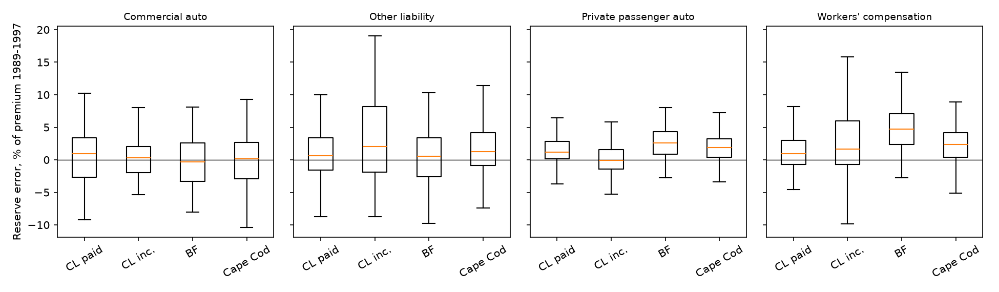
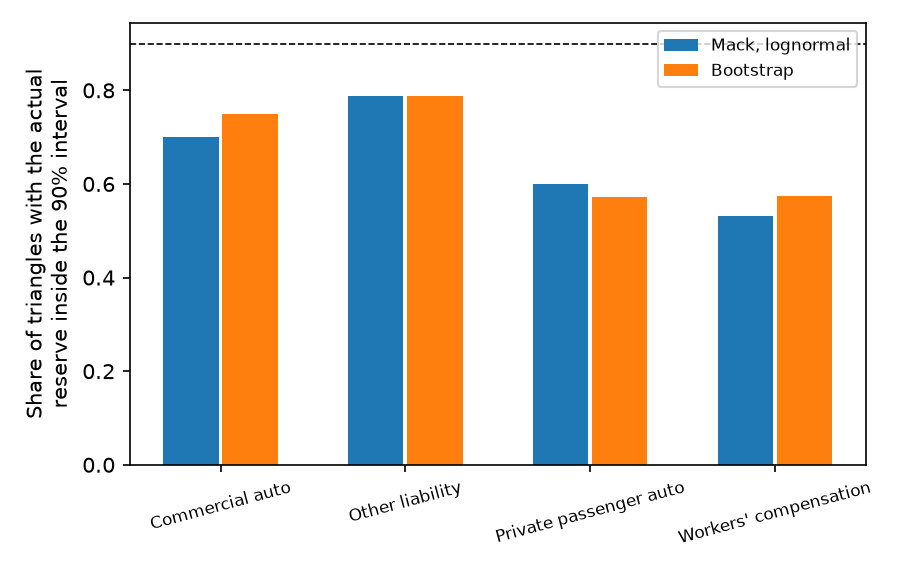

# Non-life loss reserving on the CAS Loss Reserving Database: chain ladder, Mack, over-dispersed Poisson bootstrap, Bornhuetter-Ferguson and Cape Cod, backtested on the lower triangles (v0.1)

[](https://github.com/michaelserikov/loss-reserving/actions/workflows/tests.yml)

How good are the standard reserving methods, and how honest are their uncertainty estimates? The CAS Loss Reserving Database holds, for several hundred US insurers and four lines of business, a complete 10 x 10 run-off square for accident years 1988 to 1997: the upper triangle is what was known at the end of 1997, the lower triangle is what happened afterwards. This project implements the methods from scratch (numpy), checks them against a published example, and judges them on 229 company triangles by what actually happened.

**Main findings**
- The code reproduces the textbook example. On the Taylor and Ashe (1983) triangle the chain ladder reserve is 18,680,856 and equals the published value in every accident year, Mack's standard errors of 75,535 to 1,363,155 by accident year and 2,447,095 in total (13.1% of the reserve) equal the published ones, and the over-dispersed Poisson bootstrap gives 3.03 million (16.2%).
- Chain ladder on paid claims reserves slightly too much on this data in all four lines: the median ratio of predicted to actual ultimate is 1.014 to 1.018, and the median reserve error is 0.6% to 1.2% of the premium of accident years 1989 to 1997. It is also the most accurate of the paid methods most often (40% to 60% of the triangles have the smallest absolute error with it).
- Bornhuetter-Ferguson is only as good as its prior. With the loss ratio of accident years 1988 to 1990 as the a priori (the older years, as in practice), it over-reserves private passenger auto by 2.6% and workers' compensation by 4.7% of the premium, because loss ratios fell after 1990; Cape Cod, which estimates the loss ratio from the triangle itself, lies between it and the chain ladder.
- The stochastic intervals are too narrow. A nominal 90% interval from Mack's standard error (lognormal) contains the actual reserve in 53% (workers' compensation), 60% (private passenger auto), 70% (commercial auto) and 79% (other liability) of the triangles; the bootstrap is no better (57%, 57%, 75%, 79%). The 50% intervals contain 19% to 46%. The models describe the process and parameter risk of the chain ladder, not the risk that the pattern changes.
- Against the Solvency II standard formula for reserve risk, the bootstrap 99.5% quantile of the larger half of the companies (by premium) lies 22% above the reserve for private passenger auto, against 25.5% of capital for a volatility of 9%; for commercial auto it is 41% (formula 25.5%) and for other liability 87% (formula 31.8% at 11%). The actual reserve exceeded the standard formula level in 0% of the 35 private passenger auto triangles, 13% of the 30 commercial auto triangles and 3.8% of the 26 other liability triangles. The standard formula is a one-year view and this backtest is ultimate, so these are not like for like; they show where the ultimate view is much wider.

## Methods (`src/reserving/methods.py`)

- **Chain ladder** with volume-weighted age-to-age factors (or simple averages), cumulative factors and an optional tail factor.
- **Mack (1993)**: distribution-free estimators of the variance parameters with the usual extrapolation of the last one, the mean squared error of each accident year and of the total including the covariance between years.
- **Over-dispersed Poisson bootstrap** (England and Verrall): fitted increments from the chain ladder (equal to the Poisson GLM with row and column effects), Pearson residuals adjusted for degrees of freedom and resampled, each pseudo triangle refitted and projected, process error as a gamma draw per cell with variance equal to the dispersion times the mean.
- **Bornhuetter-Ferguson** with an a priori loss ratio and **Cape Cod**, which estimates the loss ratio as the claims to date over the premium that the pattern says has been earned.
- **Solvency II**: capital of the standard formula for reserve risk, reserve times the lognormal 99.5% factor minus one, for a volatility sigma.

## Backtest (`scripts/run_backtest.py`, `scripts/analyse_backtest.py`)

Companies and lines: private passenger auto, commercial auto, workers' compensation and other liability (occurrence), 675 company triangles in the database; 229 are usable (net premium at least 0.5 million USD in every accident year, positive paid claims in the first development year and in the last). Each method sees the upper triangle only and predicts the reserve of accident years 1989 to 1997; the outcome is the paid amount in development year 10 (the incurred amount for the incurred chain ladder), and the database has no tail beyond 10 years. Error is predicted minus actual reserve over the premium of accident years 1989 to 1997 (net of reinsurance, thousand USD in the data).

| Line | Triangles | Method | Median error, % of premium | RMSE, % of premium | Share underestimated | Median ultimate ratio |
|---|---|---|---|---|---|---|
| Private passenger auto | 70 | Chain ladder, paid | 1.2 | 3.7 | 23% | 1.018 |
| | | Chain ladder, incurred | -0.1 | 4.7 | 53% | 0.999 |
| | | Bornhuetter-Ferguson | 2.6 | 4.2 | 16% | 1.033 |
| | | Cape Cod | 1.9 | 3.5 | 20% | 1.026 |
| Commercial auto | 60 | Chain ladder, paid | 1.0 | 5.5 | 40% | 1.014 |
| | | Chain ladder, incurred | 0.3 | 4.8 | 45% | 1.004 |
| | | Bornhuetter-Ferguson | -0.3 | 6.4 | 53% | 0.995 |
| | | Cape Cod | 0.1 | 5.0 | 47% | 1.002 |
| Workers' compensation | 47 | Chain ladder, paid | 1.0 | 3.6 | 38% | 1.016 |
| | | Chain ladder, incurred | 1.7 | 5.9 | 32% | 1.029 |
| | | Bornhuetter-Ferguson | 4.7 | 6.8 | 13% | 1.071 |
| | | Cape Cod | 2.3 | 4.1 | 19% | 1.041 |
| Other liability | 52 | Chain ladder, paid | 0.6 | 6.4 | 40% | 1.015 |
| | | Chain ladder, incurred | 2.1 | 9.4 | 33% | 1.048 |
| | | Bornhuetter-Ferguson | 0.5 | 7.0 | 48% | 1.013 |
| | | Cape Cod | 1.3 | 5.6 | 35% | 1.020 |





Share of the 229 triangles in which each interval contains the actual reserve (`results/backtest_coverage.csv`):

| Line | Mack, lognormal 50% | Mack, lognormal 90% | Bootstrap 50% | Bootstrap 90% | Actual above the chain ladder reserve |
|---|---|---|---|---|---|
| Private passenger auto | 23% | 60% | 23% | 57% | 23% |
| Commercial auto | 25% | 70% | 27% | 75% | 40% |
| Workers' compensation | 19% | 53% | 21% | 57% | 38% |
| Other liability | 44% | 79% | 46% | 79% | 40% |

Solvency II comparison (`results/backtest_solvency2.csv`): median coefficient of variation of the reserve (Mack and bootstrap agree within 2 percentage points) is 11% for private passenger auto, 23% for commercial auto and 33% for other liability over all triangles, and 8%, 14% and 24% in the larger half by premium, against standard formula volatilities of 9%, 9% and 11%.

## Limits

One accident period, 1988 to 1997, in a US market, net of reinsurance, 229 triangles out of 675 and a small sample per line; results for later periods or other markets can differ. Ultimate is development year 10 of the database. The Solvency II reserve risk is a one-year risk, so the quantiles above are not its calibration check. The chain ladder tail is one; the over-dispersed Poisson model needs positive column sums and takes negative increments through the residual definition. Calendar year effects and inflation are not modelled, which is part of why the intervals are too narrow. No actuarial qualification is implied; this is a research study on public data.

## Run

```bash
pip install -e ".[test]"
pytest                                   # includes the Taylor and Ashe example
python scripts/run_backtest.py 1000      # about 3 minutes on 6 cores
python scripts/analyse_backtest.py
```

## Data

[CAS Loss Reserving Database](https://www.casact.org/publications-research/research/research-resources/loss-reserving-data-pulled-naic-schedule-p) (NAIC Schedule P, 1997 data), files `ppauto_pos.csv`, `comauto_pos.csv`, `wkcomp_pos.csv`, `othliab_pos.csv` in `data/raw/`; the files are not committed. Taylor and Ashe (1983), "Second moments of estimates of outstanding claims", Journal of Econometrics 23; Mack (1993), ASTIN Bulletin 23; England and Verrall (1999), Insurance: Mathematics and Economics 25.
